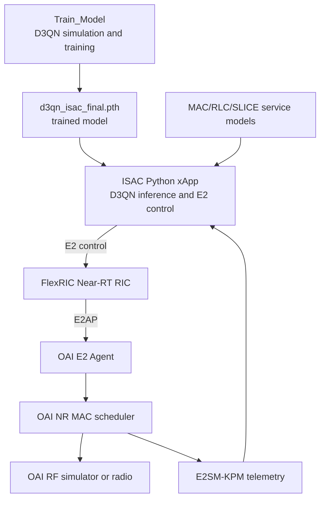
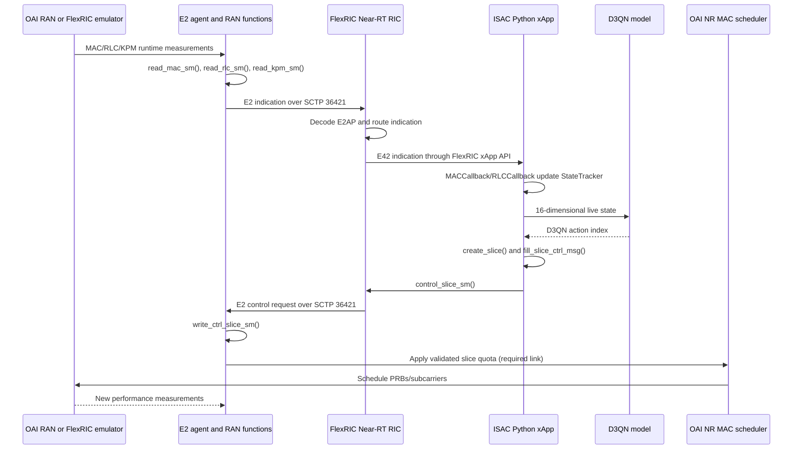

# NGN DJCSR Dynamic Subcarrier Allocation Project

## 1. Purpose

This project is an O-RAN and 6G ISAC research prototype for joint communication and sensing resource allocation. It combines:

- FlexRIC Near-RT RIC and E2 software
- OpenAirInterface (OAI) RAN source code
- A Python D3QN reinforcement-learning controller
- MAC/RLC telemetry collected through E2
- Dynamic allocation logic for eMBB, URLLC, and sensing resources
- Simulation, training, metrics, and plotting utilities

The project is intended to map onto the O-RAN architecture shown in `ORAN_Structure.jpeg`. It should be interpreted as a research prototype focused on the **Near-RT RIC, E2 interface, xApp, and OAI RAN integration**. It is not a complete implementation of every O-RAN architecture component.

## 2. High-level architecture



The current intended control path is:

```text
Offline training or saved model
        -> Python ISAC xApp
        -> FlexRIC Near-RT RIC
        -> OAI E2 agent
        -> OAI RAN service-model handler
        -> NR MAC scheduler
```

The first four steps are represented in the source. The final scheduler actuation step is incomplete for the custom SLICE service model in this repository.

## 3. Project structure

### 3.1 Root build and configuration files

| Path | Purpose | Current status |
|---|---|---|
| `CMakeLists.txt` | Builds the FlexRIC library, service models, examples, and tests | Implemented |
| `flexric.conf` | Near-RT RIC and xApp database configuration | Implemented; uses `127.0.0.1` and `/tmp/` |
| `requirements.txt` | Python dependencies for ML, plotting, and xApp support | Present |
| `README.md` | Installation, execution, architecture, and reported results | Present, but some paths and claims need verification |
| `Ngn-project.md` | This implementation and architecture status document | Documentation |

The root CMake file builds `src`, `examples`, and `test`. It does **not** directly add the separate OAI `openair2` tree to the build. OAI therefore has to be built separately using its own build system and E2 options.

### 3.2 `src/`: FlexRIC platform

The `src` directory is the FlexRIC implementation inherited or adapted from the FlexRIC project.

| Area | Role |
|---|---|
| `src/ric/` | Near-RT RIC implementation, E2 termination, endpoint management, message handling, and service-model loading |
| `src/agent/` | E2 agent API used by a RAN implementation or emulator |
| `src/lib/e2ap/` | E2AP protocol versions and ASN.1 support |
| `src/sm/` | E2 service models such as KPM, RC, MAC, RLC, PDCP, GTP, SLICE, and TC |
| `src/xApp/` | C/Python xApp SDK and supporting bindings |
| `src/util/` | Shared data structures, networking, timers, encoding, and utility functions |
| `src/ric/iApp/` | FlexRIC internal RIC-to-xApp communication mechanism |

The root CMake configuration selects E2AP and service-model encodings at configure time. The default configuration uses ASN.1 E2AP and KPM, with E2AP version 2 and KPM version 2.03 settings available through CMake options.

### 3.3 `examples/`: FlexRIC examples

This directory contains example applications and test programs:

- `examples/ric/`: Near-RT RIC executable examples
- `examples/xApp/`: C and Python xApp examples
- `examples/emulator/`: E2 node emulator examples
- `examples/CMakeLists.txt`: Example build configuration

These examples demonstrate the platform and are separate from the OAI RAN source tree.

### 3.4 `test/`: FlexRIC tests

The test directory contains tests for:

- Near-RT RIC behavior
- Agent-to-RIC communication
- xApp-to-RIC communication
- Service-model encoding and decoding
- Random data generation
- Service-model behavior
- Docker-based test environments

These tests validate FlexRIC components. They do not prove that the complete OAI/D3QN closed loop is operational.

### 3.5 `Train_Model/`: offline ISAC simulation and D3QN training

This folder contains the machine-learning and simulation pipeline.

| File | Role |
|---|---|
| `Train_Model/environment.py` | ISAC environment with multi-cell, UE, channel, sensing, throughput, latency, and subcarrier-allocation models |
| `Train_Model/agent.py` | Dueling DQN/D3QN agent, replay buffer, target network, and learning logic |
| `Train_Model/train.py` | Training and evaluation loop |

The environment models:

- Three base stations
- Five URLLC users and five eMBB users
- 8 transmit antennas per base station
- 780 subcarriers
- 30 kHz subcarrier spacing
- 3.5 GHz carrier frequency
- Communication and sensing resource allocation
- Power allocation actions
- Subcarrier spacing/allocation actions
- Path loss, LOS/NLOS behavior, fading, mobility, throughput, latency, and sensing accuracy

This is a simulation environment. It is not itself a Non-RT RIC, SMO, or live OAI scheduler.

### 3.6 `OAI_FlexRIC/`: model and experiment assets

This folder contains the assets used by the OAI/FlexRIC experiment, including:

- `d3qn_isac_final.pth`: saved trained D3QN model, when present
- `launch_topology.py`: multi-gNB and UE topology launcher
- `generate_traffic.sh`: traffic-generation helper

The trained model is loaded by the live xApp for inference. Training and live inference are separate activities.

### 3.7 `openair2/`: OAI RAN and E2 integration

This is a vendored or copied OAI source tree with FlexRIC integration code.

Important areas include:

| Path | Role |
|---|---|
| `openair2/RRC/NR/` | NR radio-resource control and CU-CP-related functionality |
| `openair2/LAYER2/NR_MAC_gNB/` | NR MAC implementation and downlink scheduler |
| `openair2/LAYER2/nr_rlc/` | NR RLC implementation |
| `openair2/LAYER2/nr_pdcp/` | NR PDCP implementation |
| `openair2/SDAP/` | SDAP functionality associated with the user plane |
| `openair2/E2AP/` | OAI E2 integration and RAN service models |
| `openair2/E1AP/` | E1 interface source and ASN.1 support |
| `openair2/F1AP/` | F1 interface source and ASN.1 support |
| `openair2/NGAP/` or `openair3/NGAP/` | 5G Core control-plane connectivity |
| `openair2/E2AP/flexric/` | FlexRIC source and Python xApp-related integration inside the OAI tree |

The OAI tree is not built by the root FlexRIC CMake invocation. It requires the OAI build system, normally with E2 support enabled.

### 3.8 `openair2/E2AP/RAN_FUNCTION/`: OAI E2 RAN functions

The E2 RAN-function layer connects OAI internal state to FlexRIC service models.

#### Standard O-RAN service models

- `O-RAN/ran_func_kpm.c`: E2SM-KPM measurement collection
- `O-RAN/ran_func_kpm_subs.c`: KPM subscription handling
- `O-RAN/ran_func_rc.c`: E2SM-RC service-model support
- `O-RAN/ran_func_rc_subs.c`: RC subscription handling
- `O-RAN/rc_ctrl_service_style_2.c`: RC control handling support
- `O-RAN/ran_e2sm_ue_id.c`: UE identity handling

#### Customized service models

All six customized RAN service models have both a C implementation and a header file under `openair2/E2AP/RAN_FUNCTION/CUSTOMIZED/`:

| Service model | Implementation and header | Role/status |
|---|---|---|
| MAC | `ran_func_mac.c`, `ran_func_mac.h` | MAC statistics and control API |
| RLC | `ran_func_rlc.c`, `ran_func_rlc.h` | RLC statistics and control API |
| PDCP | `ran_func_pdcp.c`, `ran_func_pdcp.h` | PDCP service model |
| GTP | `ran_func_gtp.c`, `ran_func_gtp.h` | GTP service model |
| SLICE | `ran_func_slice.c`, `ran_func_slice.h` | Slice service model; control currently prints/acknowledges requests |
| TC | `ran_func_tc.c`, `ran_func_tc.h` | Traffic-control service model |

Matching emulator implementations and headers also exist under `openair2/E2AP/flexric/examples/emulator/agent/` as `sm_mac.*`, `sm_rlc.*`, `sm_pdcp.*`, `sm_gtp.*`, `sm_slice.*`, and `sm_tc.*`. A second corresponding emulator copy is present under the root FlexRIC `examples/emulator/agent/` tree.

`init_ran_func.c` registers the read, setup, subscription, and control callbacks for the supported RAN functions. It conditionally registers DU functions such as MAC, RLC, and SLICE, and CU-UP functions such as TC, GTP, and PDCP.

## 4. Machine-learning implementation

### Training

`Train_Model/train.py` uses `ISACEnvironment` and `D3QNAgent` to learn a discrete policy. The D3QN network contains:

- A shared fully connected feature extractor
- A value stream estimating `V(s)`
- An advantage stream estimating `A(s,a)`
- Mean-centred Q-value calculation
- Experience replay
- A target network
- Double-DQN target selection
- Epsilon-greedy exploration

### Inference

The live controller defines a matching D3QN network in `isac_xapp.py`. It loads `d3qn_isac_final.pth` and selects an action from live state information.

The xApp state includes communication and ISAC-related quantities such as:

- Throughput
- Latency
- Packet loss or BLER
- Current resource ratios
- Power ratios
- Sensing-related state variables

The model path is currently partly hardcoded and includes `/home/ngnlab/openairinterface5g` fallbacks. These paths must be adapted for another machine.

## 5. ISAC xApp implementation

The main E2 controller is:

`openair2/E2AP/flexric/examples/xApp/python3/isac_xapp.py`

Its current responsibilities are:

1. Import the FlexRIC Python SWIG SDK.
2. Load the D3QN model.
3. Connect to E2 nodes.
4. Subscribe to MAC and RLC indications.
5. Track UE metrics and map UEs to eMBB or URLLC groups.
6. Construct the ISAC state.
7. Select a D3QN action.
8. Convert the action into eMBB and URLLC resource settings.
9. Build a slice-control message.
10. Send the control message to each connected E2 node.
11. Log throughput, latency, sensing, and resource metrics.

The xApp uses FlexRIC's Python bindings and therefore depends on a separately built and installed SWIG xApp SDK.

## 6. Currently implemented closed loop

### Implemented or substantially implemented

- FlexRIC Near-RT RIC source
- E2AP protocol handling
- E2 node agent API
- E2 node emulators
- E2SM-KPM support
- E2SM-RC support
- Custom MAC, RLC, PDCP, GTP, SLICE, and TC service-model APIs
- OAI E2 RAN-function registration
- OAI MAC and RLC telemetry collection
- Python xApp framework
- D3QN model definition and inference
- Offline ISAC environment and training code
- Model checkpoint loading
- E2 subscriptions from the ISAC xApp
- E2 control-message construction and transmission
- OAI NR MAC scheduler source
- OAI E1AP, F1AP, NGAP, X2AP, and XNAP source support
- Metrics logging and plotting utilities
- Docker/OpenShift/workshop deployment scaffolding

### Incomplete or not demonstrated by the source

The custom slice-control implementation in `openair2/E2AP/RAN_FUNCTION/CUSTOMIZED/ran_func_slice.c` currently:

- Accepts a slice-control request
- Prints whether the request is ADD, DELETE, or UE association
- Returns a control acknowledgement
- Does not update an OAI scheduler data structure
- Does not prove that the requested subcarrier or PRB allocation is applied to transmission

Similarly, the simulation's 780-subcarrier allocation is not automatically connected to the live OAI PHY/MAC scheduler. The trained model can select an action, but live actuation requires an explicit implementation that translates the control request into scheduler state.

## 7. Mapping to the O-RAN architecture image

### Service Management and Orchestration (SMO)

**Status: absent.**

The project has configuration files, Docker files, OpenShift files, and workshop scripts, but these are deployment or experiment artifacts. There is no complete SMO implementation, network-function lifecycle manager, O1 management server, or O2 cloud-management service.

### Non-RT RIC and rApps

**Status: absent as an O-RAN component; partially represented functionally.**

`Train_Model` performs policy training and optimization, which resembles a Non-RT RIC/rApp function. However:

- It is a standalone Python training program.
- It does not run inside a Non-RT RIC platform.
- There is no A1 interface.
- There is no policy service or rApp lifecycle framework.

The saved model is used by the Near-RT xApp for inference.

### Near-RT RIC

**Status: implemented in FlexRIC.**

The Near-RT RIC is provided by the FlexRIC source under `src/ric/` and the executable examples under `examples/ric/`. It manages E2 nodes, subscriptions, indications, and control messages.

The normal E2 transport uses SCTP and the conventional FlexRIC port `36421`. The FlexRIC xApp communication mechanism is separate from the O-RAN E2 interface.

### xApp

**Status: implemented.**

The ISAC xApp is the Python controller under `openair2/E2AP/flexric/examples/xApp/python3/isac_xapp.py`. It consumes live E2 telemetry, runs D3QN inference, and sends E2 control requests.

It is an application process, not a Non-RT RIC or SMO component.

### O-CU-CP

**Status: source support present; independent deployment not demonstrated.**

The OAI tree contains NR RRC and control-plane functionality. In a monolithic OAI gNB, these functions may run within one process rather than as an independently deployed O-CU-CP network function.

### O-CU-UP

**Status: source support present; independent deployment not demonstrated.**

PDCP, SDAP, GTP, and CU-UP-related E2 functions exist. The repository does not demonstrate a complete independent O-CU-UP deployment controlled through an operational E1 interface.

### O-DU

**Status: source present and central to the experiment.**

The OAI MAC and RLC layers represent the DU-side processing. MAC/RLC statistics are harvested for E2 indications. The NR downlink scheduler is the intended location for applying resource-allocation decisions.

The current custom SLICE handler is registered at the E2 boundary but does not yet update the scheduler.

### O-RU

**Status: not implemented as a separate O-RAN RU.**

The project contains OAI radio and RF-simulation support. This is sufficient for an OAI test environment, but a separately deployed O-RU with a complete Open Fronthaul implementation is not established by this repository.

### O-Cloud

**Status: deployment scaffolding only.**

The repository contains Docker, OpenShift, and workshop materials. These files support deployment experiments but do not constitute a complete O-Cloud management and orchestration implementation.

## 8. Interface status

| Interface | Status | Explanation |
|---|---|---|
| E2 | Implemented | Main interface between FlexRIC Near-RT RIC and OAI/FlexRIC E2 nodes |
| E2SM-KPM | Implemented | Used for KPM telemetry and measurements |
| E2SM-RC | Present | Used for RAN control APIs; actual custom slice actuation remains incomplete |
| FlexRIC xApp bus | Present | Internal/proprietary RIC-to-xApp communication mechanism |
| E1 | Source present | OAI E1AP source and ASN.1 support exist; independent deployment is not demonstrated |
| F1-C/F1-U | Source present | OAI F1AP source exists; independent CU-DU deployment is not demonstrated |
| NG-C/NG-U | Source present | OAI connectivity toward a 5G Core is supported in the OAI tree |
| X2/Xn | Source present | OAI protocol source exists but is not central to this single research workflow |
| O1 | Absent | No NETCONF/YANG or equivalent SMO-to-RAN management implementation |
| O2 | Absent | No O-Cloud management interface |
| A1 | Absent | No Non-RT RIC policy interface |
| Open Fronthaul CUS-plane | Unclear or not integrated | Radio and simulator code exist, but no separate RU deployment is proven |
| Open Fronthaul M-plane | Absent | No distinct RU management-plane implementation |

## 9. Runtime deployment view

The documented workflow expects separate processes and builds:

```text
5G Core
   ^
   | NG
OAI gNB / OAI RAN
   ^
   | E2 over SCTP
FlexRIC Near-RT RIC
   ^
   | FlexRIC xApp API / Python SWIG binding
ISAC Python xApp
   ^
   | model file and live E2 telemetry
D3QN checkpoint and state tracker
```

A typical experiment requires:

1. Build and install FlexRIC service models.
2. Build OAI with E2 support.
3. Start the 5G Core or RF simulator environment.
4. Start the FlexRIC Near-RT RIC.
5. Start the OAI gNB or simulator.
6. Connect UEs or simulated users.
7. Start the ISAC xApp.
8. Verify E2 subscriptions and control acknowledgements.
9. Inspect generated metrics.

A control acknowledgement confirms that the E2 message was received. It does **not**, by itself, confirm that the scheduler applied the requested allocation.

## 10. Important limitations and corrections

1. The root CMake build does not build the OAI `openair2` tree.
2. The training environment is simulation code, not a Non-RT RIC.
3. The project has no A1, O1, or O2 implementation.
4. The custom slice service model currently acknowledges and prints commands without changing scheduler state.
5. The README contains machine-specific paths such as `/home/ngnlab/openairinterface5g`; these must be changed for local execution.
6. The README refers to `xapp_isac.py` in some commands, while the inspected E2-enabled controller is `isac_xapp.py` under the nested FlexRIC/OAI path. The executable path should be checked before running.
7. Docker, OpenShift, and Helm-style files are deployment aids, not proof of a complete O-Cloud.
8. OAI CU, DU, and RU-related directories do not necessarily mean that these functions are deployed as independent O-RAN network elements.
9. Metrics produced by the digital twin should be distinguished from metrics measured from live OAI traffic.
10. Reported research results in the README should be treated as experiment claims until the exact build, model, configuration, and traffic setup are reproduced.

## 11. Current maturity summary

| Capability | Maturity |
|---|---|
| FlexRIC Near-RT RIC | Strong platform implementation |
| E2 telemetry | Implemented for KPM, MAC, and RLC paths |
| E2 control transport | Implemented at the message/API level |
| Python D3QN inference | Implemented |
| Offline ISAC training | Implemented as simulation |
| OAI RAN integration | Present, conditional on separate OAI build |
| Live scheduler actuation | Incomplete for the custom SLICE handler |
| Non-RT RIC/rApp | Not implemented as an O-RAN platform |
| SMO | Not implemented |
| A1/O1/O2 | Not implemented |
| Independent CU/DU/RU deployment | Not demonstrated |
| O-Cloud orchestration | Scaffolding only |

## 12. Final assessment

This repository is best described as a **FlexRIC and OAI-based Near-RT RIC research prototype for D3QN-driven ISAC resource-allocation experiments**.

The strongest existing vertical is:

```text
D3QN model
   -> Python ISAC xApp
   -> FlexRIC Near-RT RIC
   -> E2AP/E2 service models
   -> OAI RAN telemetry and control handler
```

The project already provides the software foundation for a 6G/O-RAN experiment. To become a complete closed-loop implementation matching the full architecture image, the next major engineering requirement is to connect the received slice-control parameters to the OAI NR MAC scheduler and then add, if required, real SMO, Non-RT RIC, A1, O1, O2, and independent CU/DU/RU components.

## 13. Complete execution flow

The application has two possible RAN sources:

1. **Current Docker test:** FlexRIC E2 emulators generate synthetic RAN measurements.
2. **Target live test:** OAI MAC/RLC/PDCP/GTP functions generate measurements from an OAI gNB or RF simulator.

Both sources use the same E2 direction after the measurement is created.



## 14. Startup and execution order

### 14.1 Offline model preparation

The model is trained before the live xApp is started:

```text
Train_Model/environment.py
   -> creates the ISAC simulation environment
   -> resets UE positions, channels, mobility, and resource state
   -> calculates communication and sensing rewards

Train_Model/agent.py
   -> creates the D3QN network
   -> selects actions using epsilon-greedy exploration
   -> stores transitions in replay memory
   -> trains the online and target networks

Train_Model/train.py
   -> runs episodes and time steps
   -> calls env.reset(), env.step(), agent.learn()
   -> saves d3qn_isac_best.pth and d3qn_isac_final.pth
```

The final checkpoint is expected at:

```text
OAI_FlexRIC/d3qn_isac_final.pth
```

The offline environment is not a live RAN and must not be used to generate live testbed measurements.

### 14.2 FlexRIC startup

The root CMake build creates the FlexRIC platform:

```text
CMakeLists.txt
   -> src/
   -> examples/
   -> test/
```

The Near-RT RIC process is started from:

```text
examples/ric/near_ric.c
```

During initialization, the RIC:

1. Reads `flexric.conf`.
2. Opens the E2 listener on SCTP port `36421`.
3. Opens the FlexRIC xApp bus on port `36422`.
4. Loads service-model plugins from `/usr/local/lib/flexric/`.
5. Registers KPM, RC, MAC, RLC, PDCP, GTP, SLICE, and TC service models.
6. Waits for E2 Setup Requests.

The RIC core is implemented under:

```text
src/ric/
```

The main responsibilities are E2 endpoint registration, message dispatch, subscriptions, indication routing, and control forwarding.

### 14.3 E2 node startup

For the current Docker test, the E2 nodes are started by:

```text
examples/emulator/agent/
```

For a live OAI test, the equivalent function is integrated into the OAI RAN under:

```text
openair2/E2AP/RAN_FUNCTION/
```

`init_ran_func_ag()` in `init_ran_func.c` fills the callback tables. Depending on the node type, it registers:

- DU: MAC, RLC, and SLICE callbacks
- CU-UP: TC, GTP, and PDCP callbacks
- All applicable nodes: KPM and RC callbacks

## 15. Telemetry path: RAN to xApp

### 15.1 MAC telemetry

The MAC callback is:

```text
openair2/E2AP/RAN_FUNCTION/CUSTOMIZED/ran_func_mac.c
read_mac_sm()
```

It reads OAI structures such as:

- UE RNTI
- Downlink and uplink aggregate bytes
- Current transport-block size
- Scheduled resource blocks
- CQI
- MCS
- BLER
- SNR
- PHR
- HARQ counters

The scheduler mutex is held while the UE list and scheduler statistics are read. The result is written to a FlexRIC `mac_ind_data_t` indication.

### 15.2 RLC telemetry

The RLC callback is:

```text
openair2/E2AP/RAN_FUNCTION/CUSTOMIZED/ran_func_rlc.c
read_rlc_sm()
```

It calls OAI RLC APIs to collect per-bearer values such as:

- RLC transmitted and received PDUs
- Transmitted and received bytes
- Retransmissions
- Dropped packets
- Buffer occupancy
- SDU delay
- Head-of-line waiting time
- UE RNTI and radio-bearer ID

The result is written to a FlexRIC `rlc_ind_data_t` indication.

### 15.3 KPM telemetry

The standardized KPM callback is:

```text
openair2/E2AP/RAN_FUNCTION/O-RAN/ran_func_kpm.c
read_kpm_sm()
```

KPM converts requested measurement names into measurement records and produces E2SM-KPM indication messages. It is separate from the customized MAC/RLC service models.

### 15.4 E2 transport and RIC routing

The E2 agent encodes the indication using the selected E2AP and service-model encoding. It sends the message to the RIC over SCTP port `36421`.

The RIC then:

1. Receives the E2AP PDU.
2. Identifies the E2 node and RAN function ID.
3. Decodes the service-model payload.
4. Finds the xApp subscription associated with the RIC request ID.
5. Forwards the indication through the FlexRIC xApp bus.

The current Docker logs confirm this path for emulated nodes. These are synthetic emulator measurements, not real RF measurements.

## 16. xApp decision path

The controller is:

```text
openair2/E2AP/flexric/examples/xApp/python3/isac_xapp.py
```

### Initialization

The xApp performs:

```python
ric.init()
conn = ric.conn_e2_nodes()
```

It then subscribes to MAC and RLC service models using:

```python
ric.report_mac_sm()
ric.report_rlc_sm()
```

The callback objects are:

```text
MACCallback.handle()
RLCCallback.handle()
```

These call:

```text
StateTracker.update_mac()
StateTracker.update_rlc()
```

### State construction

`StateTracker.get_isac_state()` creates the state supplied to the D3QN model. It combines:

- URLLC latency
- eMBB throughput
- Packet loss or BLER
- Current resource ratios
- Current power ratios
- Sensing-related state values

The checkpoint dimensions are inspected before the network is created. The xApp now fails if the checkpoint is missing or invalid instead of running an untrained random model.

### Action selection

The model function is:

```text
D3QN.get_action()
```

The action index contains two parts:

```text
resource_idx = action_idx // number_of_power_actions
power_idx    = action_idx % number_of_power_actions
```

The resource action defines the allocation direction, step size, and sensing spacing. The power action defines the sensing, URLLC, and eMBB power fractions.

## 17. Control path: xApp back to the RAN

The xApp creates the control message using:

```text
create_slice()
fill_slice_ctrl_msg()
```

The message contains:

- Slice ID
- Slice label
- UE scheduler name, normally PF
- NVS slice configuration
- Reserved capacity percentage
- eMBB and URLLC allocation values

The xApp sends the message with:

```python
ric.control_slice_sm(conn[i].id, msg)
```

The message travels through:

```text
Python xApp
   -> FlexRIC xApp API / E42 bus, port 36422
   -> Near-RT RIC
   -> E2AP control request, SCTP port 36421
   -> OAI E2 agent
   -> write_ctrl_slice_sm()
```

The current handler is:

```text
openair2/E2AP/RAN_FUNCTION/CUSTOMIZED/ran_func_slice.c
write_ctrl_slice_sm()
```

At present it identifies ADD, DELETE, and UE association messages, prints the received operation, and returns an acknowledgement. It does not yet update the OAI scheduler.

## 18. Scheduler application and feedback

The intended final step is:

```text
write_ctrl_slice_sm()
   -> validate slice IDs and percentages
   -> update shared scheduler configuration
   -> gNB_scheduler_dlsch.c reads the configuration
   -> allocate PRBs/subcarriers in each scheduling interval
   -> new MAC/RLC/KPM measurements are generated
```

The target scheduler source is:

```text
openair2/LAYER2/NR_MAC_gNB/gNB_scheduler_dlsch.c
```

The project currently lacks a confirmed shared configuration interface between `ran_func_slice.c` and the scheduler. This is the missing link in the live closed loop.

Consequently, the current behavior is:

```text
Control request received
   -> handler prints request
   -> acknowledgement returned
   -> scheduler allocation is unchanged
```

The required behavior is:

```text
Control request received
   -> validate request
   -> update scheduler state
   -> scheduler applies quota
   -> counters confirm applied quota
   -> telemetry measures the result
```

## 19. Docker execution flow

The current Docker image is built from:

```text
docker/Dockerfile.flexric.ubuntu
```

It contains:

- FlexRIC Near-RT RIC
- Installed FlexRIC service-model libraries
- E2 node emulators
- C monitoring xApps

The compose file is:

```text
docker/docker-compose.yaml
```

The current Docker execution is:

```text
emu-gnb-mono / emu-du
   -> synthetic E2 indications
   -> nearRT-RIC
   -> C monitoring xApps
```

The Docker image does not currently contain:

- The Python ISAC xApp
- PyTorch and the complete ML runtime
- The D3QN checkpoint as an xApp runtime asset
- A complete OAI gNB build
- The OAI 5G Core
- USRP access

Therefore Docker currently validates the FlexRIC E2 platform and emulator telemetry, not the full OAI/D3QN/scheduler experiment.

## 20. Execution status summary

```text
[IMPLEMENTED]
FlexRIC build and service-model loading
E2 node registration and E2 Setup
MAC/RLC/KPM indication transport
Near-RT RIC subscription routing
Offline D3QN training
Python xApp model inference code
Slice-control message construction

[PARTIAL]
Python xApp live deployment
OAI E2 integration
Customized service-model runtime support
Dockerized end-to-end execution

[MISSING]
Non-RT RIC and rApp host
A1 policy interface
SMO, O1, and O2
Independent CU/DU/RU deployment
Confirmed SLICE-to-NR-MAC scheduler actuation
Applied-quota verification counters
Live sensing telemetry from an OAI sensing/RF chain
```

The project is therefore a strong Near-RT RIC and ISAC research foundation, but its complete live execution flow is only finished after the SLICE control handler is connected to the actual NR MAC scheduler and the OAI/Python runtime is packaged and tested together.
